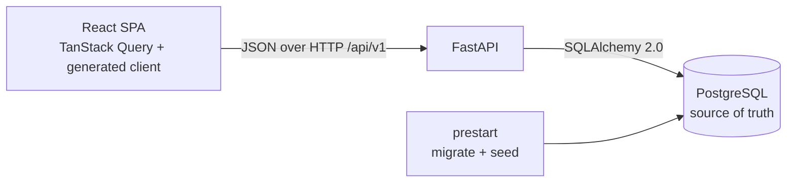

# Design document

<!-- One page. Six items required by the brief. Line budgets in comments; cut anything not listed. -->

## 1. Architecture

<!-- Diagram + 2 lines: how frontend and backend connect (generated typed client over JSON/HTTP). -->

## 2. Data model

<!-- 6 lines: zones, towns, zone_fares, trips, bookings, idempotency_keys; the two CHECKs that matter. -->

## 3. Framework and frontend choice

<!-- 3 lines: FastAPI (typed contracts, OpenAPI drives the client, DI makes services testable); React + shadcn. -->

## 4. Trade-offs

<!-- 9 lines: chose / gave up / why, for each. -->

1. **Seat counter with a conditional UPDATE and a CHECK backstop, vs summing bookings under a row lock.**
2. **Instant confirmation in Postgres only, vs Redis seat holds.**
3. **A fresh monorepo with selected template config, vs forking the template.**

## 5. Scaling to 50 routes and 10,000 bookings a day

<!-- 4 lines. ~0.12 bookings/s average, ~5/s at peak: one Postgres is fine. What changes first. -->

## 6. Monitoring

<!-- 4 lines: what to log, what to alert on. -->
