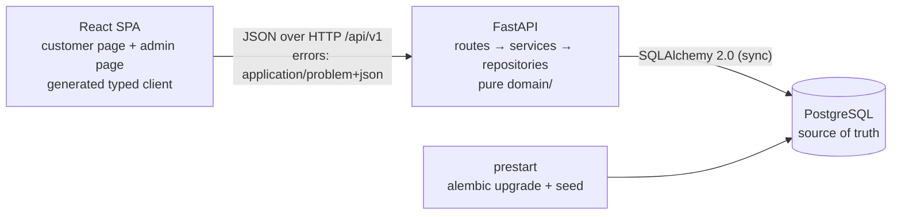

# Design document

## 1. Architecture

The backend's OpenAPI schema is the contract. `scripts/generate-client.sh` turns it into a typed TypeScript client, so a schema change that breaks the frontend fails `tsc` and doesn't wait for a user to find it. Routes hold no rules. Services own the transaction. All SQL lives in repositories. Fares, trip status and booking rules are pure Python in `domain/`, tested without a database.

## 2. Data model

| Table | Holds | Constraints that matter |
|---|---|---|
| `zones`, `towns`, `zone_fares` | 6 towns in 4 zones. One fare per unordered zone pair, in US cents | `zone_a_id <= zone_b_id`, so each pair is stored once and fares are symmetric |
| `buses` | Plate number, capacity, active flag | Unique plate. `capacity > 0` |
| `trips` | Route, bus, `departs_at` (UTC), `capacity` (copied from the bus on assignment), `seats_booked`, status | **`ck_trips_seats_range`: `0 <= seats_booked <= capacity`.** Status is a string with a CHECK, not a native enum |
| `bookings` | Reference, passenger, seats, fare snapshot, total | `total_cents = seats * fare_cents_per_seat`. Unique reference |
| `idempotency_keys`, `trip_status_history` | A replay store for `POST /bookings`. An audit row per status change | The key is claimed in the booking's own transaction |

## 3. Framework and frontend choice

**FastAPI.** Pydantic types give validation at the edge and an accurate OpenAPI schema with no extra work, and the schema drives the client. Dependency injection lets tests swap the clock, the session and the reference generator. **SQLAlchemy 2.0 rather than SQLModel**, because tables and API schemas change for different reasons. **Postgres**, because the no-overbooking guarantee depends on its row locks and CHECK constraints, which SQLite doesn't give honestly. **React with shadcn/ui and TanStack Query**: the brief asks for no custom frontend design, and the generated client keeps the frontend thin. Search state lives in the URL. Server state lives only in the query cache.

## 4. Trade-offs

1. **Seat counter with a conditional `UPDATE` and a CHECK backstop, vs summing bookings under a row lock.**
   - **Chose:** one statement, `UPDATE trips SET seats_booked = seats_booked + n WHERE … AND seats_booked + n <= capacity`. It checks and writes atomically. When two customers race for the last seat, the second waits on the row lock, re-checks, matches 0 rows and gets a 409 that includes `remaining`.
   - **Gave up:** a single source for the seat count, since `seats_booked` duplicates `SUM(bookings.seats)`.
   - **Why:** no explicit locks, constant cost, and two independent layers. `reconcile` (the CLI and an admin endpoint) catches any drift, and a 20-thread concurrency test proves the guarantee.
2. **Instant confirmation in Postgres only, vs Redis seat holds.**
   - **Gave up:** reserving seats during a long checkout.
   - **Why:** there is no payment step, so there is nothing to hold a seat for. A second state store would bring cross-store drift without solving a real problem. If a payment step arrives, holds go in Postgres first: a `held` status with `expires_at`, counted in `seats_booked`.
3. **Admin and customer booking views in one SPA, vs separate admin and booking front ends.**
   - **Chose:** one app, one build and one generated client. The admin page is a route (`/admin/trips`) that calls a separate API router (`/api/v1/admin`). Admin actions are tested endpoints, not buttons: status changes, bus reassignment and bus editing, all enforced by `domain/trip_status.py`. The dashboard is the read-only list the brief asks for.
   - **Gave up:** deploying, scaling and locking down the admin tool on its own. Its code ships to customers' browsers, though no data does without the API. There is no authentication at all, per the brief.
   - **Why:** for a prototype, a second app doubles the build and client setup for one table. The split that matters for security is on the server: the admin router is where auth goes before this is exposed anywhere, and the admin route can move to its own app later without any API change.

## 5. Scaling to 50 routes and 10,000 bookings a day

10,000 bookings a day is about 0.12 a second on average, and perhaps 5 a second at a morning peak. One Postgres instance handles that unchanged but room for replication is open. Contention per trip row is bounded by its 44 seats, and the booking path is one indexed `UPDATE` and one `INSERT`. What changes first:

1. **More API workers behind a proxy.** Anything held per process, such as future rate limits, moves to Redis.
2. **Search grows faster than bookings.**  Since the posibility of 50! potentional routes, cache towns and fares. Serve search and the dashboard from a read replica. Bookings stay on the primary.
3. **`bookings` grows by about 3.6 million rows a year.** Partition or archive completed trips by month. Purge idempotency keys on a schedule (`purge-idempotency`). The admin list already pages.
4. **Holds and payment.** Add seat holds in redis only once a payment step exists.

## 6. Monitoring

**Log** (already built):
- JSON lines carrying a request id, which also appears in every problem+json body.
- Domain events: `booking.created`, `booking.rejected` (with the reason), `trip.transitioned`, `idempotency.replayed`, and `reconciliation.drift` at ERROR.
- Passenger names, full booking references and request bodies are never logged.

**Alert on:**
- **Page:**
  - any violation of `ck_trips_seats_range` (the first layer has a bug)
  - `seat_drift_trips > 0` from a scheduled `reconcile`
  - a 5xx rate above 1% for 5 minutes
- **Ticket:**
  - a `POST /bookings` p95 above 500 ms
  - a 409 rate far above baseline
  - a trip still `scheduled` 30 minutes after `departs_at`

In production, add Grafana, Sentry and PostHog, with PII scrubbed in `before_send`, and metrics from the same events.
