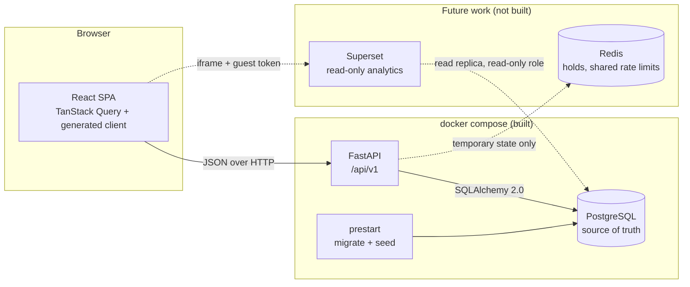
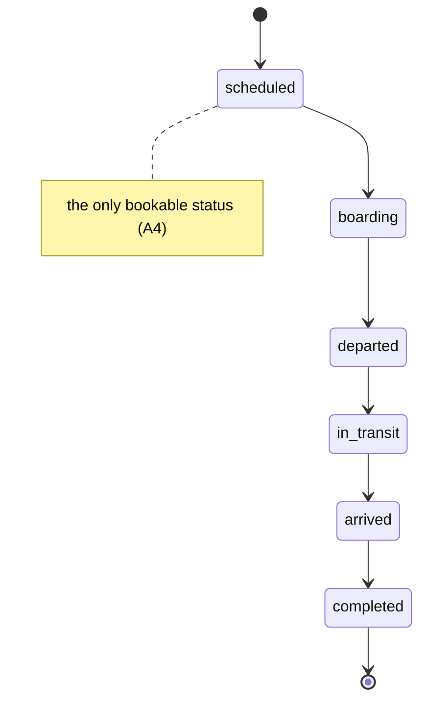
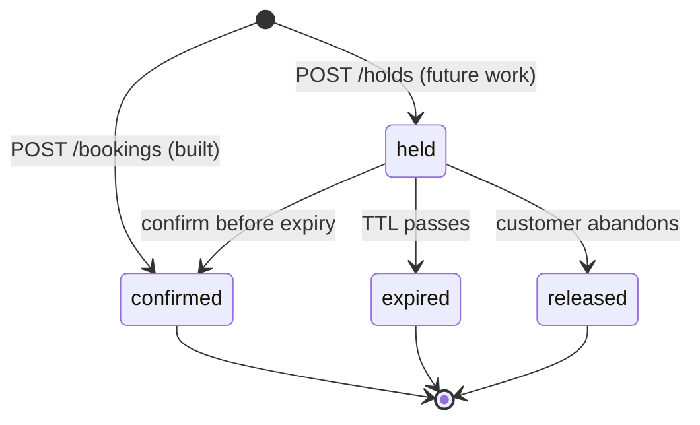

# EPIC-Africa technical assignment: build plan

Tuesday 16 November 2026. Deadline: Friday 20 November, 23:59 EAT (20:59 UTC).

## 0. Read this first

### What the brief settles

I have read the brief. The facts that shape the plan:

- 6 towns in 4 zones: Zone 1 Lagos, Ibadan; Zone 2 Enugu, Onitsha; Zone 3 Abuja; Zone 4 Kano.
- Fares are in **USD**, symmetric, one rider type. Same-zone journeys are priced.
- A booking is a name and a number of seats, returning a reference. No payment step, no numbered seats.
- The admin dashboard is a **read-only list**: route, departure time, capacity, bookings so far, status. The brief never asks for an admin to change a trip's status.
- Search is origin, destination and date. Nothing about price filters, sorting or pagination.
- Seed data: 6 towns, 4 buses, about 10 trips (capacity 40 or 44 from the assigned bus, one or two already Departed or Arrived), about 15 bookings.
- It lists as *not wanted*: production polish on every corner, elaborate deployment, auth, custom frontend, perfect coverage.
- The one edge case it names: two customers booking the last seat.
- The design doc must also cover scaling to 50 routes and 10,000 bookings a day, and it must fit one page.
- You must state your actual hours at the start of the interview, and say what you'd do with another 1–2 weeks. **Keep a time log from tonight.**

### Assumptions to put in the README

The brief says to make a sensible assumption and note it. These are yours:

| # | Assumption |
|---|---|
| A1 | Only `Scheduled` trips with a future departure can be booked |
| A2 | Origin and destination must be different towns; Lagos → Ibadan is a valid same-zone journey at $8 |
| A3 | The search date is a calendar day in Africa/Lagos; times are stored in UTC |
| A4 | The fare is per seat; a booking's total is seats × fare, fixed at booking time |
| A5 | At most 10 seats per booking, and never more than remain |
| A6 | Bookings and trips cannot be cancelled |
| A7 | Trip status changes are an operator action through the API; the dashboard is read-only as specified |
| A8 | Seats are a count per trip, not numbered |
| A9 | Every trip runs on one bus. The trip copies the bus's capacity when the bus is assigned, so a later capacity change only affects trips assigned after it |
| A10 | A trip can move to another bus only while `scheduled`, and only if the new bus is active and has at least as many seats as are already booked |
| A11 | Bus editing is an operator action through the unauthenticated admin API, the same as trip status changes |

### Where I'm overruling your choices

Your list is roughly 28–30 hours of work. The brief says 10–15 and explicitly does not want polish on every corner. The build in section 13 comes to about 14. So:

| Your choice | My call | Why |
|---|---|---|
| Embedded Superset | **Cut. Put it in "another 1–2 weeks".** | The brief's dashboard is one five-column table. Superset is 4–6 hours and a 1 GB image to render it, against "do not over-invest in the frontend" and "no elaborate deployment setups" |
| Price-range filter, status filter, pagination on customer search | **Cut.** | The brief asks for origin, destination, date, over about 10 trips. Keep one whitelisted `sort` parameter to show the pattern |
| Rate limiting, security headers | **Describe, don't build.** | "Production-grade polish on every corner" is on the brief's not-wanted list |
| Admin status-change button | **Backend endpoint only.** | The state machine is worth building and testing; the brief's dashboard is read-only, so the UI for it is optional |
| Redis seat holds | **Cut from the build. Describe in the design doc.** | With no payment step there is nothing to hold a seat *for*. Holds add a second state store and a whole class of drift bugs to solve a problem this product doesn't have. Postgres alone gives the no-overbooking guarantee |
| Redis at all | **Cut.** | Its only remaining job would be rate-limit storage, which in-memory handles for a single local process |
| SQLModel | **Replace with plain SQLAlchemy 2.0** | Section 2 |
| Postgres native enums | **Use string columns with CHECK constraints** | Section 6 |
| Cursor pagination | **Use offset** | Section 4 |
| Sentry / PostHog / Grafana | **None. JSON logs plus a reconciliation check.** | Section 11 |
| Playwright | **Delete the template's tests. One new test only as a stretch.** | Section 7 |
| Template | **Reference only: fresh monorepo, selected config copied** | Section 1 |

Cutting Redis and Superset is a design decision you can defend, and "why I didn't build holds" is a stronger interview answer than a half-working hold flow. I still give the Redis hold design in section 3 so you can describe it accurately, or build it if you disagree with me.

---

## 1. Monorepo initialisation

> **Revised 18 Nov.** The original approach was to clone the template, commit it unmodified, then strip it. That has been replaced. This repo is a fresh monorepo, and only selected config was copied from `full-stack-fastapi-template` @ `77e550a`. [THIRD_PARTY_NOTICES.md](../THIRD_PARTY_NOTICES.md) lists every derived file.

### Shape

- **uv workspace** at the root (`pyproject.toml`, `members = ["backend"]`) and **Yarn 4 workspaces** (`package.json`, `workspaces = ["frontend"]`, `nodeLinker: node-modules`).
- `backend/` and `frontend/` are separate top-level folders.
- The frontend is its own compose service (Vite on 5173). The template's approach of serving the SPA from FastAPI was dropped.
- Compose services: `db`, `adminer`, `prestart` (migrate and seed, one-shot), `backend` (8000), `frontend` (5173). One `compose.yml`, no Traefik, no override file.

### What came from the template

| Kept (adapted) | Left out |
|---|---|
| uv workspace and Docker layer-caching pattern, `alembic.ini` and `env.py`, the pydantic-settings `config.py` (psycopg-driver validator, `changethis` guard), ruff/mypy/coverage config, the `{tag}-{route_name}` operation IDs, the hey-api client config, Vite/TS/biome config, shadcn `ui/` components, `DataTable`, theme provider, CI test job | Auth/JWT, users, items, email and React Email, Mailpit, Traefik, Sentry, FastAPI Cloud and deploy workflows, Playwright, `.agents/` and `.claude/skills`, release tooling, SQLModel |

### Authorship

There's no "pristine import" commit. The first commit is the whole skeleton, and provenance is recorded in THIRD_PARTY_NOTICES instead. Push to a remote and tag the final commit `submission`.

### Architecture



### Source of truth

| Data | Authority | Notes |
|---|---|---|
| Zones, towns, fares | Postgres | Seeded reference data |
| Buses | Postgres | Seeded; operators can add and edit them through the admin API |
| Trip status, capacity, `seats_booked` | Postgres | Changed only through conditional `UPDATE`s |
| Bookings and fare snapshot | Postgres | Immutable once written |
| Idempotency records | Postgres | Written in the same transaction as the booking |
| Seat availability in the UI | Nobody: it is a hint | The server decides at booking time |
| Holds (if ever built) | Redis, temporary | Never trusted for the final decision |

---

## 2. Data model

### SQLModel vs SQLAlchemy 2.0: use SQLAlchemy 2.0

- You know SQLAlchemy. Under deadline that matters more than anything below.
- SQLModel's selling point is one class for table and API schema. That is the opposite of what you want: the table model and the API contract should change for different reasons. With SQLAlchemy models and separate Pydantic schemas the separation is structural.
- CHECK constraints, composite keys and `__table_args__` work in SQLModel but you end up writing SQLAlchemy inside it anyway.
- Alembic autogenerate with SQLModel emits `sqlmodel.sql.sqltypes.AutoString` and needs manual imports in every migration.
- Cost: swap `sqlmodel.Session` for `sqlalchemy.orm.Session` in `core/db.py` and `api/deps.py`. Ten minutes, since the models that used it are being deleted.

Stay synchronous (the template is). Async adds nothing here and makes the concurrency test harder to reason about.

### Tables

```python
# models/base.py
class Base(DeclarativeBase):
    metadata = MetaData(naming_convention={
        "ix": "ix_%(column_0_label)s",
        "uq": "uq_%(table_name)s_%(column_0_name)s",
        "ck": "ck_%(table_name)s_%(constraint_name)s",
        "fk": "fk_%(table_name)s_%(column_0_name)s_%(referred_table_name)s",
        "pk": "pk_%(table_name)s",
    })
```

```text
zones
  id            smallint PK
  name          text NOT NULL UNIQUE

towns
  id            int PK
  name          text NOT NULL UNIQUE
  zone_id       smallint NOT NULL FK zones

zone_fares                                   -- 10 rows for 4 zones, not 16
  zone_a_id     smallint FK zones
  zone_b_id     smallint FK zones
  fare_cents    int NOT NULL
  PK (zone_a_id, zone_b_id)
  CHECK ordered:  zone_a_id <= zone_b_id
  CHECK positive: fare_cents > 0

buses
  id                   int PK
  plate_number         varchar(20) NOT NULL UNIQUE   -- what the passenger looks for at the park
  name                 varchar(50)                   -- optional, e.g. "Coach 07"
  capacity             int NOT NULL
  active               bool NOT NULL DEFAULT true    -- retired or in maintenance: can't be assigned
  created_at, updated_at timestamptz
  CHECK capacity_pos:  capacity > 0

trips
  id                   uuid PK
  origin_town_id       int NOT NULL FK towns
  destination_town_id  int NOT NULL FK towns
  bus_id               int NOT NULL FK buses
  departs_at           timestamptz NOT NULL          -- UTC
  capacity             int NOT NULL                  -- copied from the bus when it is assigned
  seats_booked         int NOT NULL DEFAULT 0
  status               varchar(20) NOT NULL DEFAULT 'scheduled'
  created_at, updated_at timestamptz
  CHECK distinct_towns:  origin_town_id <> destination_town_id
  CHECK capacity_pos:    capacity > 0
  CHECK seats_range:     seats_booked >= 0 AND seats_booked <= capacity   -- the backstop
  CHECK status_valid:    status IN ('scheduled','boarding','departed','in_transit','arrived','completed')
  INDEX (origin_town_id, destination_town_id, departs_at)                 -- customer search
  INDEX (status, departs_at)                                              -- admin list, "stuck" query
  INDEX (bus_id)

bookings
  id                   uuid PK
  reference            varchar(12) NOT NULL UNIQUE
  trip_id              uuid NOT NULL FK trips
  passenger_name       varchar(100) NOT NULL
  seats                int NOT NULL
  fare_cents_per_seat  int NOT NULL                 -- snapshot at booking time
  total_cents          int NOT NULL
  created_at           timestamptz NOT NULL
  CHECK seats_pos:   seats > 0
  CHECK total_match: total_cents = seats * fare_cents_per_seat
  CHECK name_present: length(btrim(passenger_name)) > 0
  INDEX (trip_id)

idempotency_keys
  scope           varchar(40)                       -- e.g. 'bookings.create'
  key             varchar(255)
  request_hash    char(64) NOT NULL                 -- sha256 of canonical JSON body
  response_status smallint NOT NULL
  response_body   jsonb NOT NULL
  created_at      timestamptz NOT NULL
  PK (scope, key)
  INDEX (created_at)                                -- TTL cleanup

trip_status_history                                 -- first thing to cut if behind
  id bigserial PK, trip_id FK, from_status, to_status, changed_at timestamptz
```

Notes:
- **Fare on the trip?** No. Trips derive their fare by joining `zone_fares` on `LEAST(oz, dz), GREATEST(oz, dz)`. Ten rows; the join is free. The fare is copied onto the booking, so later fare changes never alter history.
- **Capacity on the trip as well as the bus?** Yes, on purpose. A CHECK can't read another table, so if capacity lived only on `buses`, the `ck_trips_seats_range` backstop would be lost and the seat `UPDATE` would need a join. The trip copies the bus's capacity when the bus is assigned. Changing a bus's capacity never changes existing trips.
- **Status lives on the trip, not the bus.** A trip is one bus running one route at one time. The bus's own state is just `active`.
- **Reassigning a bus** (for example after a breakdown) is one conditional `UPDATE`, in the same style as the seat update, so it can't race with a booking:
  ```sql
  UPDATE trips SET bus_id = :bus_id, capacity = :capacity, updated_at = now()
  WHERE id = :trip_id AND status = 'scheduled' AND seats_booked <= :capacity
  RETURNING ...
  ```
  If no row comes back, the service reads the trip again to decide between 404 and 409. The service checks that the bus is `active` before running the update.
- **Not prevented: one bus on two overlapping trips.** Doing it properly needs trip end times and a Postgres `EXCLUDE` constraint on a time range. This is out of scope; list it as a trade-off.
- Bookings have no status column in the built version: a row exists only if it is confirmed. Add one only if you build holds.
- Money is integer US cents everywhere; the brief prices in USD.

Seed values for `zone_fares` (cents), 10 rows covering all 16 ordered pairs:

| | Z1 | Z2 | Z3 | Z4 |
|---|---|---|---|---|
| **Z1** | 800 | 1800 | 2500 | 3500 |
| **Z2** | | 1000 | 1800 | 2800 |
| **Z3** | | | 800 | 2200 |
| **Z4** | | | | 800 |

---

## 3. State management and drift

### Trip lifecycle



One module owns the rules. Nothing else in the codebase compares statuses.

```python
# domain/trip_status.py  (pure, no imports from the app)
class TripStatus(StrEnum): ...

TRANSITIONS: Mapping[TripStatus, frozenset[TripStatus]] = {
    TripStatus.SCHEDULED:  frozenset({TripStatus.BOARDING}),
    TripStatus.BOARDING:   frozenset({TripStatus.DEPARTED}),
    ...
    TripStatus.COMPLETED:  frozenset(),
}
BOOKABLE: frozenset[TripStatus] = frozenset({TripStatus.SCHEDULED})

def assert_transition(current: TripStatus, target: TripStatus) -> None: ...  # raises InvalidTransition
```

The write is conditional on the status the service just read, so two admins clicking at once cannot skip a step:

```sql
UPDATE trips SET status = :target, updated_at = now()
WHERE id = :id AND status = :current
RETURNING id;          -- 0 rows -> 409 "status changed, reload"
```

Tests: a parametrised test over all 36 (from, to) pairs asserting exactly the 5 allowed ones pass.

**Booking vs status race.** The booking `UPDATE` (below) includes `status = 'scheduled'` in its `WHERE`. Under READ COMMITTED, if an admin's transition commits while the booking is waiting on the row lock, Postgres re-evaluates the `WHERE` against the new row version and the booking fails. No extra locking needed. This is worth saying out loud in the interview.

### Booking lifecycle

Built version: a booking is created confirmed, in one transaction, or not at all. There is no intermediate state, which means there is nothing to drift.



### The Postgres guarantee

Two independent layers. Either alone prevents overbooking.

```sql
-- Layer 1: atomic conditional update. The check and the write are one statement.
UPDATE trips
SET    seats_booked = seats_booked + :n, updated_at = now()
WHERE  id = :trip_id
  AND  status = 'scheduled'
  AND  departs_at > now()
  AND  seats_booked + :n <= capacity
RETURNING id, origin_town_id, destination_town_id;

-- Layer 2: CHECK (seats_booked >= 0 AND seats_booked <= capacity)
-- Catches any future code path, script or manual UPDATE that bypasses layer 1.
```

Zero rows returned means "no". The service then runs a plain `SELECT` to say *why* (not found → 404; wrong status or departed → 409 `trip-not-bookable`; otherwise 409 `insufficient-seats` with `remaining`). That diagnosis is advisory; the decision was already made atomically.

Two customers racing for the last seat: both `UPDATE`s target the same row, the second waits on the row lock, re-checks the `WHERE` after the first commits, matches zero rows, and gets a 409.

### Reconciliation

The counter is a denormalisation, so it gets a check:

```sql
SELECT t.id, t.seats_booked AS counter, COALESCE(SUM(b.seats), 0) AS actual
FROM   trips t LEFT JOIN bookings b ON b.trip_id = t.id
GROUP  BY t.id
HAVING t.seats_booked <> COALESCE(SUM(b.seats), 0);
```

- `python -m app.cli reconcile` prints drifted trips and exits non-zero.
- `GET /api/v1/admin/reconciliation` returns the same list.
- The concurrency tests end by asserting this query returns nothing.
- Production: run every few minutes, export `seat_drift_trips` as a gauge, page on `> 0`. Never auto-repair; drift means a bug.

### Holds: recommendation and the design you'd describe

**Not built.** If the brief turns out to require a hold step, build it in Postgres, not Redis: a `status` (`held`/`confirmed`/`expired`) and `expires_at` on `bookings`, with held seats included in `seats_booked`. One store, so no cross-store drift.

```sql
-- confirm
UPDATE bookings SET status = 'confirmed'
WHERE id = :id AND status = 'held' AND expires_at > now() RETURNING id;   -- 0 rows -> 410 hold-expired

-- release expired holds (run lazily before any availability read for that trip, and on a timer)
WITH expired AS (
  UPDATE bookings SET status = 'expired'
  WHERE status = 'held' AND expires_at <= now() RETURNING trip_id, seats)
UPDATE trips t SET seats_booked = seats_booked - e.total
FROM (SELECT trip_id, SUM(seats) AS total FROM expired GROUP BY trip_id) e
WHERE t.id = e.trip_id;
```

TTL: 5 minutes. The form is a name and a number; anything longer just locks seats.

**The Redis version, for the design doc and panel questions:**

- Per trip, a sorted set `trip:{id}:holds`. Member `"{hold_id}:{seats}"`, score = expiry in ms. Expired members are trimmed inside every script call, so no reliance on key-expiry events.
- Redis is admission control only. Availability shown = `capacity - seats_booked` (Postgres) minus live holds (Redis).

```lua
-- KEYS[1] = trip:{id}:holds   ARGV = now_ms, ttl_ms, hold_id, seats, free_per_postgres
redis.call('ZREMRANGEBYSCORE', KEYS[1], '-inf', ARGV[1])
local held = 0
for _, m in ipairs(redis.call('ZRANGE', KEYS[1], 0, -1)) do
  held = held + tonumber(string.match(m, ':(%d+)$'))
end
if held + tonumber(ARGV[4]) > tonumber(ARGV[5]) then return 0 end
redis.call('ZADD', KEYS[1], ARGV[1] + ARGV[2], ARGV[3] .. ':' .. ARGV[4])
return 1
```

| Failure | What happens |
|---|---|
| Redis restarts, holds lost | Confirm returns 410 `hold-expired`; customer re-holds. No overbooking: Postgres never knew about the hold |
| Hold expires before confirm | 410 `hold-expired`; UI returns to results and refetches |
| Hold expires *during* confirm | Hold validity is checked once at the start. After that Postgres decides: if the conditional update succeeds, the booking stands |
| Stale `free_per_postgres` passed to the script | Redis may admit one hold too many; the conditional update rejects the loser at confirm |
| Two customers, one seat | Lua is single-threaded, one hold wins. If Redis is wrong, the Postgres row lock settles it |

### Frontend state

- **Server state** lives only in TanStack Query. Keys: `['towns']`, `['trips', searchParams]`, `['admin', 'trips', params]`.
- **Search state** lives in the URL (TanStack Router `validateSearch`), so results are shareable and survive refresh.
- **Local UI state** (`useState`): which trip's booking form is open, form field values, the confirmation just received.
- Trips queries: `staleTime` 15s, refetch on window focus. Availability is labelled as a count, never as a promise.
- After a successful booking: `invalidateQueries({ queryKey: ['trips'] })`.
- On 409 `insufficient-seats`: show the `remaining` value from the problem body and invalidate the same key. This path is the real stale-data handling; demo it.
- The `Idempotency-Key` is generated once when the form opens (`crypto.randomUUID()`) and reused across retries of that submission.

---

## 4. API design

Base path `/api/v1` (template default). Version in the path; additive changes stay in v1; a breaking change gets `/api/v2` mounted beside it.

### Endpoints

```text
GET  /api/v1/health                               200
GET  /api/v1/towns                                200 TownOut[]
GET  /api/v1/fares/quote?origin_town_id&destination_town_id
                                                  200 FareQuote           404 422
GET  /api/v1/trips                                200 TripPage            422
GET  /api/v1/trips/{trip_id}                      200 TripOut             404
POST /api/v1/bookings                             201 BookingOut          404 409 422
GET  /api/v1/bookings/{reference}                 200 BookingOut          404

GET  /api/v1/admin/trips                          200 TripPage            422
POST /api/v1/admin/trips/{trip_id}/transitions    200 TripOut             404 409 422
GET  /api/v1/admin/reconciliation                 200 DriftReport

GET   /api/v1/admin/buses                         200 BusOut[]
POST  /api/v1/admin/buses                         201 BusOut              409 422
PATCH /api/v1/admin/buses/{bus_id}                200 BusOut              404 422
PUT   /api/v1/admin/trips/{trip_id}/bus           200 TripOut             404 409 422
```

Bus endpoints: a duplicate plate number is a 409. Changing a bus's capacity doesn't touch trips it is already on (assumption A9). Reassigning a trip returns 409 if the trip isn't `scheduled`, the bus is inactive, or the bus has fewer seats than are already booked (A10).

The quote endpoint exists because the README must show "a journey being priced". It is a thin wrapper over the pure fare function.

```text
TownOut      { id, name, zone_id }
FareQuote    { origin: TownOut, destination: TownOut, fare_cents, currency: "USD" }
BusRef       { id, plate_number, name }
BusOut       { id, plate_number, name, capacity, active }
BusIn        { plate_number: str(1..20), name?: str(..50), capacity: int(1..100) }
BusPatch     { name?, capacity?: int(1..100), active? }
BusAssignIn  { bus_id: int }
TripOut      { id, origin: TownOut, destination: TownOut, bus: BusRef, departs_at (UTC, ISO 8601),
               status, capacity, seats_booked, seats_available, fare_cents, currency: "USD" }
TripPage     { items: TripOut[], total, limit, offset }
BookingIn    { trip_id: uuid, passenger_name: str(1..100), seats: int(1..MAX_SEATS) }
BookingOut   { reference, trip: TripOut, passenger_name, seats,
               fare_cents_per_seat, total_cents, created_at }
TransitionIn { to_status: TripStatus }
DriftReport  { checked_at, drifted: [{ trip_id, counter, actual }] }
```

`MAX_SEATS` per booking is 10 (assumption A5; the brief is silent). Over the cap is a 422; over the remaining seats is a 409.

### Search, filter, sort

```text
GET /api/v1/trips
  origin_town_id       int
  destination_town_id  int
  date                 YYYY-MM-DD, a calendar day in Africa/Lagos
  sort                 Literal["departs_at", "-departs_at", "price", "-price"]  (default departs_at)
  limit                1..100 (default 20)
  offset               >= 0
```

- That is the whole filter set. The brief asks for origin, destination and date over about 10 trips; price-range and availability filters would be untested surface area. If asked, the answer is "add a parameter, a `Literal` or range type, and one `where` clause in the repository".
- The public endpoint always filters to bookable, future trips with at least one seat. `/admin/trips` shows every trip in every status.
- **Date:** `[local midnight, next local midnight)` in `ZoneInfo("Africa/Lagos")`, converted to UTC, queried as a half-open range on `departs_at`. Lagos is UTC+1 with no DST; use `zoneinfo` anyway so the code doesn't hard-code the offset.
- **Whitelisting:** `sort` is a `Literal` type, so FastAPI rejects anything else with a 422 before your code runs. The repository maps it through a dict of column expressions. No user string ever reaches `order_by` or `text()`.

```python
SORTS = {"departs_at": (Trip.departs_at.asc(), Trip.id.asc()),
         "-departs_at": (Trip.departs_at.desc(), Trip.id.asc()),
         "price": (ZoneFare.fare_cents.asc(), Trip.departs_at.asc(), Trip.id.asc()), ...}
```

- **Pagination: offset.** Result sets are small (one route, one day), the admin table wants page numbers and a total, and sort order is user-selectable, which makes keyset cursors fiddly (a different cursor encoding per sort). The `id` tie-breaker keeps pages stable. Cursor pagination is right for an unbounded, append-heavy feed; say that in the trade-offs and move on.

### Errors: one format

`application/problem+json`. Cite RFC 9457, which obsoleted 7807 in 2023 with the same shape; knowing that is a cheap point with a panel.

```json
{
  "type": "https://errors.local/insufficient-seats",
  "title": "Not enough seats",
  "status": 409,
  "detail": "2 seats requested, 1 remaining.",
  "instance": "/api/v1/bookings",
  "code": "insufficient-seats",
  "request_id": "b1f0…",
  "remaining": 1
}
```

- Domain exceptions (`TripNotFound`, `TripNotBookable`, `InsufficientSeats`, `InvalidTransition`, `IdempotencyKeyReused`) map to problems in one exception handler in `core/errors.py`. Services never import FastAPI.
- Override the `RequestValidationError` handler to return the same shape with an `errors: [{ field, message }]` list. **Drop Pydantic's `input` value from each error**, otherwise a rejected passenger name is echoed into responses and logs.
- A catch-all handler returns a generic 500 problem with the `request_id` and no trace.

### Idempotency

Applies to `POST /bookings` (and hold confirmation, if ever built).

| Aspect | Decision |
|---|---|
| Header | `Idempotency-Key`, any string up to 255 chars; the frontend sends a UUID. Optional on the API so `curl` stays simple; the frontend always sends it |
| Scope | `(scope, key)` where scope is the operation name. No per-user scope because there are no users |
| Storage | `idempotency_keys` in Postgres, **written in the same transaction as the booking** |
| Replay | Same key, same body hash → stored status and body returned, plus `Idempotent-Replayed: true` |
| Mismatch | Same key, different body hash → 422 `idempotency-key-reused` |
| What is stored | Successful results only. A 409 rolls the transaction back, leaving no record, so a retry re-evaluates against current truth, which is safe |
| TTL | 24 hours; `python -m app.cli purge-idempotency` deletes older rows. Cron in production |

Flow inside one transaction:

```text
1. INSERT INTO idempotency_keys (...) ON CONFLICT (scope, key) DO NOTHING
2. inserted  -> run the booking, UPDATE the row with the response, COMMIT
   conflict  -> SELECT the row; compare hashes; replay or 422
```

Two concurrent requests with the same key: the second `INSERT` blocks on the unique index until the first transaction finishes, then either sees the committed row (replay) or, if the first rolled back, inserts and proceeds. No "in progress" state to manage. This is a good thing to explain on a whiteboard.

### Keeping OpenAPI clean for the generated client

- Keep the template's `generate_unique_id_function` (`{tag}-{route_name}`) and the client config that strips the tag prefix. Route function names become client method names, so name them deliberately: `search_trips`, `create_booking`, `transition_trip`.
- Tags: `towns`, `trips`, `bookings`, `admin`, `health`. One per router.
- Every route sets `response_model` and `status_code`, and declares its error responses: `responses={409: {"model": Problem}, 404: {"model": Problem}}`, so the client gets typed errors.
- Regenerate the client in the same commit as any schema change.

---

## 5. Folder structure and business logic

```text
backend/app/
├── main.py                    # app factory: middleware, exception handlers, router mount
├── cli.py                     # seed, reconcile, purge-idempotency
├── api/
│   ├── deps.py                # dependency injection lives here
│   ├── main.py                # api_router
│   └── routes/                # HTTP only: parse, call one service method, shape response
│       ├── health.py  towns.py  trips.py  bookings.py  admin_trips.py  admin_buses.py
├── core/
│   ├── config.py              # pydantic-settings
│   ├── db.py                  # engine, session factory
│   ├── errors.py              # Problem schema, exception handlers
│   ├── logging.py             # JSON formatter, request-id middleware
│   └── rate_limit.py
├── domain/                    # pure Python: no SQLAlchemy, no FastAPI
│   ├── fares.py
│   ├── trip_status.py
│   ├── references.py
│   └── errors.py
├── models/                    # SQLAlchemy tables only
│   ├── base.py  geography.py  bus.py  trip.py  booking.py  idempotency.py
├── schemas/                   # Pydantic API contracts only
│   ├── common.py  town.py  bus.py  trip.py  booking.py
├── repositories/              # all SQL lives here
│   ├── buses.py  trips.py  bookings.py  fares.py  idempotency.py
├── services/                  # orchestration and transactions
│   ├── booking_service.py  trip_service.py  bus_service.py  reconciliation.py
└── alembic/
backend/tests/
├── unit/         # domain/, no database
├── integration/  # services and repositories against Postgres
└── api/          # TestClient
```

Dependency injection, in `api/deps.py`:

```python
SessionDep = Annotated[Session, Depends(get_session)]

def get_booking_service(session: SessionDep) -> BookingService:
    return BookingService(session, TripRepository(session), BookingRepository(session),
                          FareRepository(session), IdempotencyRepository(session),
                          clock=utcnow, new_reference=generate_reference)

BookingServiceDep = Annotated[BookingService, Depends(get_booking_service)]
```

Injecting `clock` and `new_reference` is what makes "past departure" and "reference collision" testable without sleeping or monkeypatching. Don't add abstract repository interfaces; with one implementation each they are ceremony, and a panel may ask what they buy you.

### Fare calculation

```python
# domain/fares.py
FareTable = Mapping[tuple[int, int], int]          # (low_zone, high_zone) -> cents

def fare_for_zones(origin_zone: int, destination_zone: int, table: FareTable) -> int:
    key = (min(origin_zone, destination_zone), max(origin_zone, destination_zone))
    ...                                             # KeyError -> FareNotConfigured

def quote(origin: TownRef, destination: TownRef, table: FareTable) -> int:
    if origin.id == destination.id: raise SameTownError
    return fare_for_zones(origin.zone_id, destination.zone_id, table)
```

Symmetry is true by construction: the lookup normalises the pair, and the table's CHECK makes the reversed row impossible to store.

### Booking flow and where each guarantee lives

| Step | What happens | Guarantee enforced | Layer |
|---|---|---|---|
| 1 | `GET /trips` | Whitelisted filters; only bookable future trips | Router types, repository |
| 2 | `POST /bookings` arrives | Shape, seat range, name normalisation | Pydantic schema |
| 3 | Idempotency insert | A retry cannot create a second booking | `PK (scope, key)` |
| 4 | Conditional seat update | No overbooking; bookable status; future departure | Single `UPDATE`, row lock |
| 5 | Fare quote | Correct, symmetric price | Pure function |
| 6 | Insert booking with fare snapshot and reference | Price fixed forever; reference unique | `CHECK total_match`, `UNIQUE (reference)` |
| 7 | Store response on the idempotency row, commit | Steps 3–7 are all-or-nothing | One transaction |
| 8 | 201 with reference | | Router |
| Any time | Anything bypasses the service | Counter still cannot exceed capacity | `CHECK seats_range` |

### Booking references

- Format `BK-XXXX-XXXX`: 8 characters from Crockford base32 (no I, L, O, U), generated with `secrets.choice`. About 1.1 × 10¹² values (40 bits).
- Hard to guess because it comes from a CSPRNG, carries no sequence or timestamp, and isn't derived from the id. Production would rate limit the lookup endpoint to make enumeration impractical.
- Collisions: `UNIQUE` constraint; the insert runs in a savepoint and retries with a new reference up to 3 times. Test this by injecting a generator that returns a duplicate first.
- Be ready for the follow-up: a reference alone reveals a passenger name. In production, lookup would need the reference plus a second factor (phone or surname).

---

## 6. Alembic workflow

**How the template does it.** `app/alembic/env.py` reads the database URL from settings and sets `target_metadata = SQLModel.metadata`. The `prestart` compose service waits for the database, runs `alembic upgrade head`, then runs `initial_data.py` to create the first superuser.

**Changes:**

1. `env.py`: `from app.models import Base` and `target_metadata = Base.metadata`. Make `app/models/__init__.py` import every model module, or autogenerate silently sees no tables.
2. Remove the `sqlmodel` import from `script.py.mako`.
3. Naming convention on `Base.metadata` (section 2). Give every CHECK an explicit short name (`CheckConstraint(..., name="seats_range")`), which the convention expands to `ck_trips_seats_range`.
4. **Delete the template's migrations and generate one fresh initial migration.** Nothing was ever deployed from them, so there is no database to migrate forward. Keeping them would leave a history that creates `user` and `item` and then drops them, which is noise you'd have to explain. State this choice in the README.

**Enums.** Don't use native Postgres enum types. Autogenerate doesn't detect added values, `ALTER TYPE ... ADD VALUE` has transaction restrictions, downgrades need manual `DROP TYPE`, and tests that recreate schemas trip over leftover types. Use:

```python
status: Mapped[TripStatus] = mapped_column(
    Enum(TripStatus, native_enum=False, length=20, create_constraint=False,
         values_callable=lambda e: [m.value for m in e]),
    nullable=False, server_default=TripStatus.SCHEDULED.value)
# plus an explicit CheckConstraint("status IN (...)", name="status_valid") in __table_args__
```

Caveat to know: autogenerate also doesn't detect changes to CHECK constraints, so adding a status means a hand-written drop-and-recreate of one constraint. That is still two lines and fully transactional.

**Rules:**

- Read every autogenerated migration before committing. In the initial one, confirm all CHECKs, both indexes and the constraint names are present.
- Never edit a migration that has been applied anywhere shared. Before first push you may regenerate the initial migration freely; after that, only add new ones.
- No data in schema migrations.

**Seeding.** Replace `initial_data.py` with `python -m app.cli seed`, called from the prestart script after migrations:

- Reference data (4 zones, 6 towns, 10 fares): idempotent upserts, safe on every start.
- 4 buses (two with 40 seats, two with 44), upserted by plate number. Dummy plates, e.g. `TEST-001`.
- About 10 trips, inserted only if `trips` is empty, each assigned a bus and copying its capacity, with departure times relative to now so the panel always sees future trips whenever they run it. Seven or eight `scheduled` in the next few days; one `departed` and one `arrived` with departure times in the past.
- About 15 bookings, **created through the booking service's own code path**, not raw inserts, so every counter is correct by construction. The departed and arrived trips need bookings too: seed those while the trip is still `scheduled`, then advance it through the state machine. The seed therefore exercises both state machines on every start.
- Make one scheduled trip end up with exactly one seat left, for the last-seat demo.
- The seed finishes by running the reconciliation check and failing loudly if it finds drift.
- README "reset or reseed" (the brief asks for this): the `down -v` command below.

**Local reset:** `docker compose down -v && docker compose up -d --build`.

**Tests get a clean schema** by running `alembic upgrade head` against a separate `app_test` database once per session (section 7). This means the migration itself is tested on every run. Don't use `Base.metadata.create_all` in tests; it would hide a migration that has drifted from the models.

---

## 7. Test-driven development plan

### Order

1. **`domain/fares.py`** (unit, no DB)
   - All 16 ordered zone pairs, parametrised against the expected table from the brief.
   - Symmetry: `fare(a, b) == fare(b, a)` for all pairs.
   - Same zone, different towns: priced.
   - Same town: `SameTownError`.
   - Missing table entry: `FareNotConfigured`.
2. **`domain/trip_status.py`** (unit): all 36 (from, to) pairs; `BOOKABLE` membership.
3. **`domain/references.py`** (unit): format, alphabet, no duplicates in 10,000 draws.
4. **Booking service** (integration, real Postgres)
   - Happy path: counter increments, fare snapshot and total correct.
   - Exact remaining seats succeeds; remaining + 1 fails with `remaining` reported.
   - Each non-bookable status rejected (parametrised over the 5).
   - Past departure rejected, using the injected clock.
   - Unknown trip.
   - Reference collision retried.
   - Idempotency: replay returns the same booking and the counter moves once; same key with a different body raises; a key used on a failed attempt can be retried.
   - **Last seat:** capacity 1, 20 threads released together by a `threading.Barrier`, each with its own session. Exactly 1 success, 19 `InsufficientSeats`, `seats_booked == 1`, reconciliation empty.
   - **Many seats:** capacity 5, 20 threads × 1 seat → exactly 5 succeed.
   - **Same idempotency key, 10 threads:** exactly 1 booking row.
   - Direct `UPDATE trips SET seats_booked = capacity + 1` raises `IntegrityError`. This proves layer 2 independently.
5. **Trip service** (integration): valid transition persists and writes history; invalid raises; stale `current` status returns conflict.
   - **Bus reassignment:** succeeds while `scheduled` and copies the new capacity; fails with a conflict when the trip isn't `scheduled`, the bus is inactive, or the bus has fewer seats than `seats_booked`. Changing a bus's capacity leaves existing trips unchanged.
   - Reassignment racing a booking for the last seats (threads + `Barrier`): the CHECK is never violated and reconciliation is empty.
6. **API** (TestClient)
   - Seats 0, negative, over the cap, non-integer → 422 problem+json.
   - Names: blank, whitespace only, 101 chars, control characters → 422. `Ọláyíwọlá Chukwuémeká`, `Ngọzi`, and a name with an apostrophe and hyphen → 201, round-tripped exactly.
   - 422 bodies do not contain the submitted name.
   - Search: date boundary (a 23:30 UTC trip belongs to the *next* Lagos day), each filter, each sort, `sort=evil` → 422, limit cap, pagination stability.
   - Every error response has content type `application/problem+json` and a `request_id`.
   - Admin transition endpoint: 200, 409, 404.
   - Admin bus endpoints: create 201, duplicate plate 409, capacity 0 → 422, PATCH unknown bus 404, reassign 200/404/409.

Keep the red-green rhythm visible in the commit history for at least the fare and booking service work (`test: …` then `feat: …`). The panel will look at your commits.

### Infrastructure

- **Reuse** the template's pytest config, `TestClient` fixture and coverage setup. Delete its user/item tests and fixtures.
- **Database:** the template runs tests against the dev database. Change that: `conftest.py` creates `app_test` on the same Postgres container if missing, runs Alembic once per session, and overrides `get_session`.
- **Isolation:** `TRUNCATE trips, bookings, idempotency_keys, trip_status_history RESTART IDENTITY CASCADE` after each test; reference data is seeded once and left. One mechanism for everything. Transaction-rollback isolation is faster but can't be used for the concurrency tests, which need real commits on separate connections, and two isolation schemes is one too many this week.
- **Factories:** plain functions (`make_trip(session, *, capacity=10, status=..., departs_in=timedelta(hours=2))`). Skip factory_boy.
- **Redis:** not applicable. For the record, if you built holds: use the real Redis container. fakeredis needs `lupa` for Lua and its script semantics aren't guaranteed identical, and the Lua script is exactly the thing under test.

### Playwright

Delete the template's e2e tests; they exercise login and user settings. A single happy-path test (search → book → see reference) is about 45 minutes including fixing the Playwright config that assumed auth. It sits below the cut-line: write it only if everything else is done by Thursday night. The backend tests are where the brief's weight is.

---

## 8. Frontend

Timebox: 3 hours total. Use shadcn components unstyled beyond defaults.

### Routes

| Add | Remove |
|---|---|
| `/` search, results and booking | `/login`, `/signup`, `/recover-password`, `/reset-password` |
| `/admin/trips` read-only trips table | `/_layout/settings`, `/_layout/items`, `/_layout/admin` |
| | The auth guard in `_layout`, `useAuth`, token handling in the client setup |

### Customer view

```text
routes/index.tsx                     search params validated here (origin, destination, date, sort, page)
└── SearchPage
    ├── TripSearchForm               Select × 2 (towns query), date input, sort Select -> navigate({ search })
    ├── TripResults                  useQuery(['trips', search])
    │   ├── ResultsSkeleton | EmptyState | ErrorAlert (renders problem.detail)
    │   ├── TripCard × n             route, local departure time, fare, seats left, "Book"
    │   │   └── BookingForm          inline under the selected card; name Input, seats Input
    │   │       └── useMutation(createBooking, headers: Idempotency-Key)
    │   └── Pagination
    └── BookingConfirmation          replaces the form inline: reference, total, trip summary
```

- Times shown in Africa/Lagos with `Intl.DateTimeFormat(…, { timeZone: 'Africa/Lagos' })`, regardless of the browser's zone.
- Money formatted from cents with `Intl.NumberFormat('en-US', { style: 'currency', currency: 'USD' })`.
- The brief requires the reference to appear inline on the same page after booking. `BookingConfirmation` replacing the form in place satisfies that; do not navigate away.
- Problem responses are rendered from `detail`; field errors from `errors[]` are mapped onto the form.

### Admin: recommendation is a plain trips table

| | (a) Trips table page | (b) Embedded Superset |
|---|---|---|
| Setup | ~45 minutes, reusing the template's table pattern | 4–6 hours: Superset image, its metadata DB, `superset init`, a dashboard built by hand or imported, `EMBEDDED_SUPERSET` flag, guest-token endpoint, CORS and frame-ancestors config, embedded SDK |
| Meets the brief | Exactly: a list with route, departure, capacity, bookings so far, status | Yes, with far more machinery than the requirement |
| Can change trip status later | Yes, one button | No. Superset is read-only |
| Panel runs `docker compose up` | Starts in seconds | Adds a ~1 GB image and a slow first boot to a live demo |
| Fits "don't over-invest in the frontend" | Yes | No |
| What it's actually good for | Operations | Analytics: load factor, revenue by route, bookings over time |

Build (a):

```text
routes/admin/trips.tsx
└── AdminTripsPage                   banner: "Trusted-only: no authentication, per the brief"
    └── TripsTable                   route, departure, bus (plate), capacity, bookings so far, status Badge
        └── AdvanceStatusButton      STRETCH ONLY: shows the single next status; useMutation(transitionTrip)
                                     409 -> toast "Status changed elsewhere" + invalidate
```

The five columns are the brief's list, in the brief's order. The advance button is a stretch: the transition endpoint is built and tested regardless, and in the demo you can call it from `/docs`. If you do add the button, include `next_status` on the admin `TripOut` so the rule stays in the backend and isn't duplicated in TypeScript.

Superset goes in the design doc's future-work line: read-only dashboards against a replica, a dedicated read-only database role, guest tokens minted by the backend.

---

## 9. Security

| Area | Build | Notes |
|---|---|---|
| Input validation | Pydantic at the edge: types, ranges, lengths; name is NFC-normalised, trimmed, 1–100 chars, no control characters, Unicode letters allowed | Don't restrict to ASCII; Nigerian names use diacritics |
| SQL | SQLAlchemy expressions and bound parameters only; no f-strings in `text()` | Add a ruff rule or a grep in CI if you want to show it |
| Sort/filter | `Literal` types plus a dict of column expressions | Section 4 |
| Rate limiting | **Not built; described.** | Production: slowapi backed by Redis, keyed on the real client IP behind the proxy; search 60/min, booking 10/min, lookup 20/min; 429 as problem+json |
| CORS | The template builds the list from `BACKEND_CORS_ORIGINS` and `FRONTEND_HOST`. Keep the explicit list, set `allow_credentials=False` (no cookies or auth now), restrict methods to GET and POST, allow the `Idempotency-Key` header and expose `Idempotent-Replayed` and `X-Request-ID` | Never `*` |
| Headers | **Not built; described.** | `nosniff`, frame denial, referrer policy, CSP and HSTS belong at the reverse proxy in production |
| Error responses | Catch-all handler, generic 500 problem, trace only in server logs | Test it by making a route raise |
| Admin endpoints | Separate router under `/api/v1/admin`, tag `admin`, description "Trusted-only: unauthenticated by design per the brief". Attach one no-op `require_admin` dependency at router level with a docstring | That dependency is the single seam where OIDC/JWT with a role claim would go. Production also: not exposed publicly, audit log of transitions |
| PII (NDPA 2023) | Passenger names never logged. Log `booking_id`, `trip_id`, `seats`. No request bodies in logs. Validation errors stripped of `input` | Add a test that books with a distinctive name and asserts it doesn't appear in captured logs |
| Dependencies | `uv run pip-audit` and `bun audit` (or `npm audit`) run once before submission; record the result in the README | Add as a CI step if it takes under 10 minutes |

Superset risks, for the doc only: guest tokens must be short-lived, minted server-side, scoped to one dashboard with row-level security clauses; the database connection must use a read-only role; embedding needs a strict `frame-ancestors`; and Superset's own `SECRET_KEY` signs those tokens, so leaking it gives read access to everything the role can see.

---

## 10. Secrets, and working with AI tools

Without auth or email, the only secret is the Postgres password. The plan is small on purpose.

1. `.env` was never created in the repo. Only `.env.example` exists, and it uses `changethis` placeholders.
2. `.env` is in `.gitignore`. `.env.example` holds only the variables that survive (`POSTGRES_*`, `DATABASE_URL`, `TEST_DATABASE_URL`, `PROJECT_NAME`, `ENVIRONMENT`, `BACKEND_CORS_ORIGINS`, `FRONTEND_HOST`), and `Settings` matches it.
3. README quick start: `cp .env.example .env && docker compose up`. The example values must work as-is locally; the panel will not generate passwords.
4. Keep the template's guard that refuses to start outside `local` with a `changethis` value.
5. **gitleaks** in `.pre-commit-config.yaml`:

```yaml
- repo: https://github.com/gitleaks/gitleaks
  rev: <pin a release tag>
  hooks:
    - id: gitleaks
```

6. **AI tools:**
   - Never paste a real credential into a prompt. In this project there are none to paste, but the handover note should state the rule.
   - Keep `.env` out of assistant context. Claude Code: `.claude/settings.json` with `"permissions": { "deny": ["Read(./.env)", "Read(./.env.*)"] }`. Cursor: `.cursorignore`. Commit these; they are evidence of the practice.
   - Examples and prompts use obvious dummies (`postgres://app:example@db/app`).
7. **`.claude/skills` and `.agents/skills`:** not copied from the template. If you add agent skills of your own, name them in the AI disclosure. The disclosure must be true: tools used, what for, and what you verified yourself.
8. **Superset** (not built): its `SUPERSET_SECRET_KEY` and metadata DB credentials would live in `.env` with placeholders in `.env.example`, and the app database would be reached through a separate read-only role.

---

## 11. Observability

The brief asks you to *describe* production monitoring. Build the cheap foundation, describe the rest.

| Tool | What it adds | Setup cost here | This assignment | Real production |
|---|---|---|---|---|
| Sentry | Grouped exceptions with context, release tracking | 15 min for the SDK, but it's a cloud service (or a very heavy self-host) | **No.** Conflicts with "runs locally, nothing paid/cloud" | **Yes.** First thing to add; scrub passenger names in `before_send` |
| PostHog | Product analytics, funnels (search → book conversion) | 1–2 h; cloud or heavy self-host | **No.** Answers a question nobody asked | Later, once there's a product question; PII review first |
| Prometheus + Grafana + Loki | Metrics, dashboards, log search, alerting | 2–3 h for compose services, exporters and one dashboard | **No.** Three more containers in a live demo for something the brief only asks you to describe | **Yes**, or a managed equivalent |
| JSON logs + request IDs + reconciliation | Everything above depends on these | 30–45 min | **Yes** | Yes |

### What to build

- Middleware: accept or generate `X-Request-ID`, store it in a `contextvar`, return it on the response, include it in every log line and every problem body.
- stdlib `logging` with a JSON formatter (python-json-logger or a 20-line formatter). One access-log line per request: method, route template (not the raw path), status, duration.
- Domain events at INFO: `booking.created` (booking_id, trip_id, seats, total_cents), `booking.rejected` (trip_id, reason), `trip.transitioned` (trip_id, from, to), `idempotency.replayed`, `reconciliation.drift` at ERROR.
- Never: passenger names, full booking references (log the first 4 characters if needed), request bodies.

### What to alert on in production

| Alert | Signal | Severity |
|---|---|---|
| Overbooking attempt blocked by the CHECK | `IntegrityError` on `ck_trips_seats_range` | Page: layer 1 has a bug |
| Seat drift | `seat_drift_trips > 0` from the reconciliation job | Page |
| 5xx spike | 5xx rate over 1% for 5 min | Page |
| Booking failure spike | Non-409 booking failures; separately, 409 rate far above baseline | Ticket / page by rate |
| Trips stuck | `scheduled` more than 30 min past `departs_at`; `boarding` over 1 h; `in_transit` over expected duration + margin | Ticket to operations |
| Latency | p95 of `POST /bookings` over 500 ms | Ticket |
| Rate-limit hits | Sustained 429s from one source | Ticket |

---

## 12. Trade-offs

| Decision | Chosen | Gave up | Why |
|---|---|---|---|
| Template vs scratch | Fresh monorepo with selected template config | The template's ready-made compose and auth scaffolding | Nothing to strip, no auth coupling, every file is deliberate; provenance in THIRD_PARTY_NOTICES |
| SQLModel vs SQLAlchemy 2.0 | SQLAlchemy 2.0 + Pydantic | The template's default; one class per entity | Table models and API schemas change for different reasons; cleaner constraints and migrations |
| Admin UI | Plain trips table | Analytics dashboards | Superset can't perform status changes and costs 4–6 h |
| Redis holds vs instant confirm | Instant confirm, Postgres only | Seat reservation during a long checkout | No payment step means nothing to hold for; one store means no drift |
| React SPA vs server-rendered | SPA from the template | Simpler deployment, no client build | Typed client generated from OpenAPI makes the API contract the centrepiece |
| Counter + conditional update vs sum under lock | Counter | A single source for seat count (it's denormalised) | One atomic statement, O(1), no explicit locks; reconciliation check covers the denormalisation |
| Postgres vs SQLite | Postgres | Zero-setup local run | Real row locking and CHECK semantics; the concurrency test is meaningless on SQLite |
| Cursor vs offset | Offset | Stable pages under heavy concurrent inserts; deep-page performance | Small result sets, selectable sort, admin wants totals |
| Native enum vs string + CHECK | String + CHECK | Type-level enum in the database | Transactional, reversible migrations |
| Idempotency store | Postgres, same transaction | Sub-millisecond lookups, automatic TTL | Atomic with the booking; no "key saved but booking lost" window |
| Sync vs async SQLAlchemy | Sync | Higher concurrency per worker | Template default, simpler tests, irrelevant at this load |
| Fare on trip vs derived | Derived, snapshotted on booking | A simple column to sort by | One place to change a fare; history can't be altered |
| Capacity on bus only vs copied to trip | Copied to the trip on assignment | One place to change capacity | Keeps the `seats_range` CHECK and the single-table seat `UPDATE`; a bus change can't break trips already sold |
| Prevent one bus on overlapping trips | Not enforced | Protection against double-scheduling a bus | Needs trip end times and an `EXCLUDE` constraint; out of scope for the prototype |

### The three for the design document

1. **Seat counter with a conditional update and CHECK backstop, vs summing bookings under a row lock.** This is the core correctness decision and the one the concurrency test proves.
2. **Instant confirmation in Postgres only, vs Redis seat holds.** Shows you can decline complexity, and lets you explain drift without having built it.
3. **A fresh monorepo with selected template config, vs forking the template.** The panel will ask what you wrote regardless; put your answer in writing first.

Keep counter-vs-lock and offset-vs-cursor ready as spoken answers.

---

## 13. Scope and schedule

### Estimates

| Part | Hours |
|---|---|
| Monorepo init, compose green, CI green | 2.0 |
| Models, constraints, initial migration, seed (towns, trips, bookings) | 1.75 |
| Fares, state machine, references (TDD) | 0.75 |
| Booking service, concurrency tests, idempotency | 2.5 |
| Trip service, transitions, reconciliation | 0.75 |
| Routes, problem+json, search, fare quote, API tests | 1.75 |
| Request IDs, JSON logs, CORS | 0.5 |
| Customer frontend | 1.75 |
| Admin table | 0.75 |
| Design doc, README, handover, AI disclosure | 1.5 |
| Fresh-clone run-through, buffer | 0.5 |
| **Total** | **14.5** |

That is inside the brief's range with almost no slack, and every stretch item excluded. For comparison, the items I cut: Superset 4–6 h, Redis holds 4–5 h, Grafana stack 2–3 h, Playwright 0.75 h, rate limiting and headers 0.5 h, extra search filters 0.5 h.

The brief counts hours from Saturday 14 November and asks you to state your real total. Include the planning time you have already spent.

### Risks

| Risk | Mitigation |
|---|---|
| Monorepo init drags on | 2-hour timebox; the skeleton is deliberately empty of domain code |
| The panel reads the submission as over-engineered for a 10-trip prototype | Every extra (idempotency, reconciliation, problem+json) must have a test and one sentence of justification; anything without both gets cut |
| Concurrency test is flaky | Each thread gets its own session and connection; raise the pool size in the test engine to at least the thread count; use a Barrier, not sleeps |
| Demo data has no future trips on interview day | Seed uses times relative to now; re-run `down -v && up` before the interview |
| Docs squeezed to the last hour | Draft the design doc Thursday, while the decisions are fresh |
| Day job eats an evening | Cut-line below, applied early rather than at 23:00 Friday |

### Cut-line

Drop in this order as soon as you are more than an hour behind:

1. `trip_status_history`
2. `GET /bookings/{reference}`
3. Sort by price (keep departure-time order)
4. Reconciliation HTTP endpoint (keep the CLI command and the test assertion)
5. Idempotency. It is your own spotted edge case, not the brief's; if it goes, list double-submit as a known limitation
6. problem+json for validation errors (keep it for domain errors)

Never cut: the conditional update and CHECK, the last-seat concurrency test, the fare tests, the state machine tests, the seed data, both frontend views, the four documents. Those are what the brief grades.

### Schedule (EAT)

| When | Hours | Work | Done means |
|---|---|---|---|
| **Tue/Wed evening** | 2.0 | Check assumptions against the brief. Monorepo init (section 1). | `cp .env.example .env && docker compose up` works; health endpoint responds; smoke tests pass; pushed |
| **Wed evening** | 4.5 | Models, migration, seed. Fares, state machine, references by TDD. Booking service with concurrency and idempotency tests. | Backend core green; the last-seat test passes 20 times in a row |
| **Thu evening** | 4.5 | Trip service and reconciliation. All routes, error handling, search. Logging and request IDs. Regenerate client. Start the customer page. Draft the design doc (30 min). | Every endpoint works from `/docs`; API tests green |
| **Fri evening** | 4.5 | Finish customer page, admin table. README, handover note, AI disclosure. `pip-audit`. Fresh clone into a temp directory and follow your own README. | **Final commit pushed and tagged by 21:00.** Hard stop 22:00 |

Nothing after 22:00 on Friday except fixing a broken README command. A commit at 23:55 looks like panic; one at 21:00 looks like planning.

---

## 14. Deliverables mapping

Each deliverable below follows the brief's own bullet list. Use the brief's bullets as the headings so the panel can tick them off.

### Design document: one page, six required items

One page is tight for six items. Budget lines, and cut anything not on this list.

| Brief requires | Source | Budget |
|---|---|---|
| Architecture, incl. how frontend and backend connect | §1 diagram, reduced to the three built boxes; one sentence on the generated client | Diagram + 2 lines |
| Data model | §2 as a five-line table list with the two CHECKs that matter | 6 lines |
| Framework and frontend choice | FastAPI: typed contracts, OpenAPI drives the client, DI makes the service testable. React from the template: reused components, typed client | 3 lines |
| Three trade-offs: chose / gave up / why | §12, the three recommended | 9 lines |
| Scaling to 50 routes, 10,000 bookings a day | Below | 4 lines |
| Monitoring: what to log, what to alert on | §11 | 4 lines |

**The scaling answer.** 10,000 bookings a day is about 0.12 per second on average, perhaps 5 per second at a morning peak. One Postgres instance handles that without changes, and saying so plainly is the senior answer. Contention on a trip row is bounded by its 44 seats. What actually changes first:

1. More API workers behind a proxy, which is when state held in process (rate limits) has to move to Redis.
2. Search traffic grows far faster than bookings: cache towns and fares, add a read replica for search and the dashboard, keep bookings on the primary.
3. `bookings` grows by 3.6 million rows a year: paginate the dashboard, archive or partition completed trips by month.
4. Seat holds become worthwhile once there is a payment step.

### README

| Brief requires | Content |
|---|---|
| What it does, 2–3 sentences | Write last |
| How to run locally | `cp .env.example .env && docker compose up`; URLs for the app, `/docs`, Adminer; how to run tests; **how to reset and reseed** (`docker compose down -v && docker compose up`) |
| Example: a journey priced and a seat booked | Two `curl` commands with real output: `GET /fares/quote` for Lagos → Abuja returning 2500, then `POST /bookings` returning a reference |
| Main entry points, backend and frontend | `backend/app/main.py`, `services/booking_service.py`, `domain/fares.py`, `domain/trip_status.py`; `frontend/src/routes/index.tsx`, `routes/admin/trips.tsx` |
| Assumptions | A1–A8 from section 0 |
| (yours) Provenance | At the top: upstream URL and SHA, the fact that this is a fresh monorepo rather than a fork, and a pointer to THIRD_PARTY_NOTICES |

### Handover note: exactly three things

The brief asks for the three most important things, not a manual. Recommended three:

1. **Seat counts change in one place.** The conditional `UPDATE` in the trip repository, backed by the CHECK. Never write `seats_booked` anywhere else, never read-then-write it. Run `reconcile` if in doubt; any drift is a bug.
2. **Business rules live in `domain/` and are pure.** To change a fare, change the seed table. To add a status, edit `TRANSITIONS`, write the one-constraint migration by hand, and extend the parametrised test. Routers and repositories contain no rules.
3. **Migrations and what is deliberately missing.** Review every autogenerated migration and never edit an applied one. Admin endpoints are unauthenticated by design: the `require_admin` dependency is where auth goes, and it must go in before this is exposed anywhere.

### AI use disclosure: the brief's four questions

| Question | How to be ready for it |
|---|---|
| Which parts by hand, which AI-assisted | Keep a running note as you work; reconstructing it on Friday night will be inaccurate. This plan itself is AI-assisted and should be listed |
| Which tools | Name them, including whether the template's agent skill folders were used or deleted |
| How you verified | Tests written before the code for fares and booking; reading every migration; the concurrency test run repeatedly; a fresh-clone run of the README |
| Where you deliberately didn't use AI, and why | **Decide this tonight.** My suggestion: write the conditional update, the booking service transaction and the last-seat test yourself. It is the part the panel will probe hardest, and "I wrote the part I'd be paged for" is a strong answer |

### The interview

- Opening: your actual hours.
- "Another 1–2 weeks": seat holds with a payment step, auth on admin, rate limiting, Superset or a metrics dashboard, Sentry and metrics, a status-change UI, an e2e test. Everything cut in section 0 goes here, which is why cutting it costs you nothing.
- The deep-dive will ask "where would you change X". Rehearse three: add a rider type with a discount (pure function in `domain/fares.py` plus a column on the booking snapshot); add a Cancelled status (`TRANSITIONS`, one migration, seat release in the same transaction); add a seventh town (one seed row, no code).
- Demo path: search Lagos → Abuja → book the one-seat trip in two browser tabs at once → one gets a reference inline, the other a 409 and a refreshed list → the admin table shows the new count → show the row and the CHECK in Adminer → advance the trip to `boarding` from `/docs` and show the booking now refused → run `reconcile` → show the last commit and tag.
